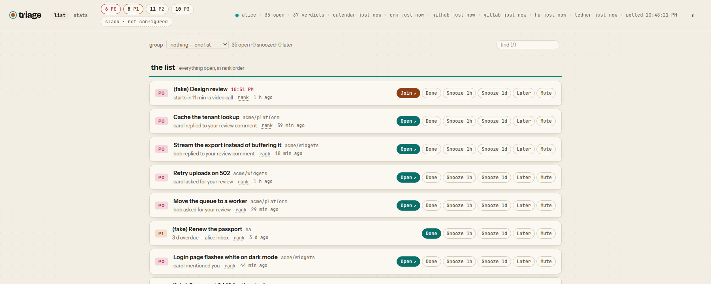

# triage

Your queue, ranked. Triage reads the places work waits for you — GitHub
notifications, GitLab todos, your calendar, and a few optional sources —
into one SQLite store, decides with plain rules how much each thing needs
you, and shows everything as one ordered list. The few things that cannot
wait (someone replied to you, asked for your review, a meeting starts in
fifteen minutes) reach you in Slack within a minute.



- **Deterministic.** Rules, not a model. Every verdict is logged with the
  rule that made it, so you can always ask why something is where it is —
  or why it did or did not interrupt you.
- **Quiet by default.** Only a short list of rules interrupts; everything
  else waits in the list. What interrupts is yours to change, per source
  and per project.
- **One process.** Node ≥ 24, built-in `node:sqlite`, no build, no
  container, nothing else to run.

## Try it

```bash
git clone https://github.com/by-de-sine/triage.git && cd triage
npm run demo     # http://127.0.0.1:3300 — every source on canned data, in memory, no credential, nothing sent
npm test         # under a second, no network
```

No `npm install` needed: the only dependencies are for the optional Slack
app. The demo is what the screenshot above shows — every source on its
fake, delivery off, nothing leaves your machine.

## Use it

1. **A GitHub token.** If `gh auth login` has been run, triage uses its
   token (it must be a classic token — the notifications API does not
   accept fine-grained ones). Or a GitLab token, or both.
2. **Start it:** `node server.js`, then open http://127.0.0.1:3300.
3. **Get interrupted.** Create a Slack incoming webhook to a channel only
   you are in, and add two lines to `~/.config/triage/.env`:

   ```bash
   TRIAGE_WEBHOOK_URL=https://hooks.slack.com/services/…
   # Your Slack member id. Without it the message is a badge, not a notification.
   TRIAGE_MENTION=U0123ABCD
   ```

   A Discord webhook or any endpoint that takes JSON works too.

Everything else is optional — see [configuration](docs/configuration.md).
Your credentials live in that `.env`, in the files it names beside it, or
in the `gh` and `glab` stores a token is borrowed from — and nowhere else.
What triage holds, and what it does with it, is in
[SECURITY.md](SECURITY.md).

## Sources

| Source | Reads | Interrupts on |
|---|---|---|
| [GitHub](docs/sources/github.md) | notifications; optionally the open issues of named repositories | replies to you, mentions, review requests, new pull requests |
| [GitLab](docs/sources/gitlab.md) | todos, your merge requests and issues; optionally open issues | the same |
| [Calendar](docs/sources/calendar.md) | an ICS feed (or Google Calendar) | 15 minutes before a meeting; an unanswered invitation |
| [Ledger](docs/sources/ledger.md) | a markdown queue file agents write their asks to | nothing |
| [Home Assistant](docs/sources/home-assistant.md) | to-do lists | nothing |
| [CRM](docs/sources/crm.md) | Twenty's tasks and notes, read-only | a task handed to you or changed under you |

## Documentation

- [Using the list](docs/using.md) — the page, acting on items, reports
- [Interrupts](docs/interrupts.md) — what reaches Slack, and making it yours
- [Ranking](docs/ranking.md) — tiers and the order
- [Configuration](docs/configuration.md) · [HTTP API](docs/api.md) · [Deploying](docs/deploy.md)
- [Architecture](docs/architecture.md) — the four seams and the store
- [History](docs/history.md) · [The plan](docs/plan.md)

## Contributing

Pull requests are welcome, from people and from their agents.
[CONTRIBUTING.md](CONTRIBUTING.md) is how to work on the tree — the
layout, the seams, running an instance against a fake, where a test goes,
and what happens to a pull request once it is open. [AGENTS.md](AGENTS.md)
is the short version for an agent working in a checkout. A new source is
the most common contribution and the most welcome; the walkthrough is
[there](CONTRIBUTING.md#adding-a-source).

[MIT](LICENSE).
