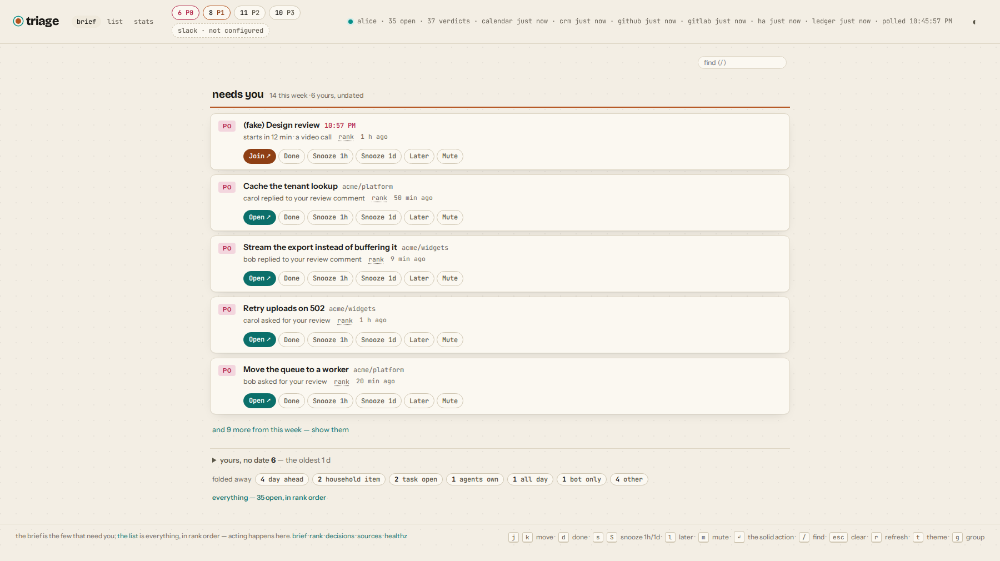
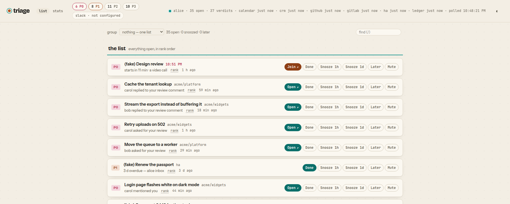
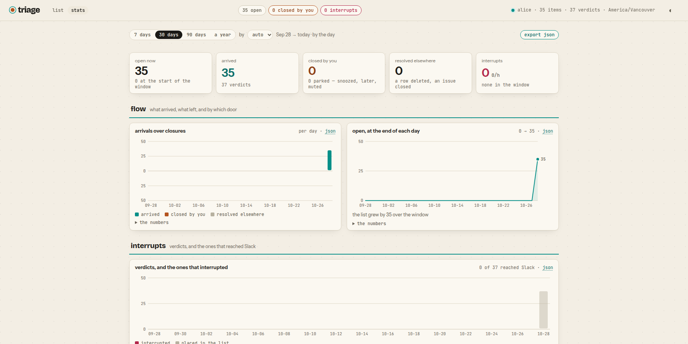

# Using the list

Two views of one store. The **brief** is what the page opens on: the few
things that need you, and everything else as counts. The **list** is
everything, in rank order — one press away, and where you search.

## The brief



`/`, and `GET /api/brief`. It is a read of the same items the list holds,
and it asks nothing of you first — nothing has to be sorted before it gets
shorter.

| | |
|---|---|
| **needs you** | what needs you and began to this week, in rank order, five at a time (`and N more` shows the rest). Each row is the list's own row: the same sentence, the same buttons, and a choice's answers as buttons |
| **slipping** | an older one, on the day it has waited 7, 14, 30, 60 or 90 days — said once as it crosses the line, then not until the next |
| **still waiting on you** | every other item that needs you: a count and its oldest. Opens into its rows |
| **yours, no date** | what is yours with no clock on it: a count and its oldest. Opens into its rows |
| **folded away** | everything else — news, bots, other people's — as counts by the rule that put it there. A count is the list narrowed to that rule |
| **not being read** | a source that has been failing for half an hour or more, and since when |

**What "needs you" means** is read off what the rules already said, never
judged again: an item whose [tier](ranking.md#tiers) is P0 or P1, unless
its source says time has finished with it — news (a merged pull request, a
note somebody edited) goes stale rather than waits, and a meeting that has
happened is over. *Yours, no date* is a P2 on something that waits.

The same brief goes out as [one message a day](interrupts.md#the-brief),
on a day there is something to say.

The list is at `/?view=all` (the **list** link), and any narrowing or
grouping opens it. The list, `GET /api/lists`, `/triage` and the Slack Home
tab all show the same order, from `lib/lists.js`, so they cannot disagree
about what is first.

## The list



One ordered list of everything open — every tier, in [rank](ranking.md)
order. **Snoozed** and **Later** are their own groups after it, because
they are states rather than ranks; snoozed is ordered by wake time.

Each row says where it is from by its kind — a thread shows its repository;
a meeting shows when it starts (red inside the fifteen minutes) and offers
**Join** beside **Open** — and **why it is where it is**: the top term's
sentence, with the rank and the whole match set on hover.

**Group** with `?group=repo|source|tier|kind|owner`: groups each list
without reordering it, each group in the rank order of its best item.
`owner` is *what it takes* — a ledger row's owner kind, a thread's
repository. The grouping is a preference, kept in `localStorage`.

**Narrow** with `?tier=&repo=&source=&owner=&rule=&q=` (`rule` is the
strongest rule that fired, which is what the brief folds by; `q` is a word
from the title, key or repository). Filters live in the URL, so a reload or a
pasted link asks the same question. Counts (`more`, "N open") are of what
matches; counts by tier stay the whole queue's. On the page the tier tiles
are those filters, and `/` focuses the find box.

**Keyboard:** `j`/`k` (or the arrows) move, `d` done, `s`/`S` snooze 1 h /
1 d, `l` later, `m` mute, Enter or `o` takes the row's main action, `/`
finds, `g` groups, `r` reloads, `t` switches theme.

In Slack (app path only), `/triage` is read-only text — a word narrows it:
`queue`, `snoozed`, `later` — and the Home tab puts a menu on every line.
The app serves one person; anyone else who opens it is told whose queue it
is.

## Acting

Every surface calls one function, `act()`, and every action is a row in
`actions` with who did it (`web`, `slack`, `api`, or whatever a caller
says).

| Action | What it does |
|---|---|
| **Done** | `state = done`, plus whatever the item's source does: GitHub marks the thread read, GitLab marks the todo done, Home Assistant ticks the item off. The calendar, the ledger and the CRM are read-only, and Done says so. If the far end refuses, the item is still done and the reason is on the action row. A done item **reopens** on a new P0–P2: you handled it; now there is more |
| **Snooze** | `state = snoozed` until a time. The first poll after it wakes the item and writes a `snooze_wake` decision: a P0 is sent at once; anything else is back in the list. Buttons offer 1 h and 1 d; the API takes an ISO time or `30m` / `1h` / `1d`. New activity does not wake it early |
| **Later** | `state = later`: sinks beneath every open item, with no date. Re-tiered on new activity but stays sunk; only a new P0 lifts it |
| **Mute** | `state = muted`: still tiered and logged, never delivered, never reopened |
| **Reopen** (`open`) | back to open with a fresh rank — the undo for the four above. On the page and the API, not a Slack button. (The **Open** button is a link to the thread) |
| **Answer** | `{action: "answer", choice: "B"}` — for an item that carries choices, like a [ledger](sources/ledger.md#asking-through-the-ledger) `[confirm: …]` row. `state = done`, and the choice is on the action row for whoever asked to read back. A wrong letter is refused with the list |
| **Seen** | `{action: "seen"}` — nothing changes; a row says you looked, and when. For a surface that presents an item without owning it (an attention report that lists the item with a tick beside it) to record the tick where the [response and changelog reports](#reports) read it. The item stays where it was: Done is for handled, Seen is for "I know". Not a button on the page or in Slack |

The system's own moves are actions too: `wake` when a snooze ends,
`reopen` when a done item draws new activity, and `resolved`
(`by = source:<name>`) when its source says it is finished — a ledger row
deleted, a task completed, an issue closed, a pull request
[merged](sources/github.md#the-sweep). Only your own actions are feedback.

```bash
curl -X POST localhost:3300/api/items/12/act -H 'content-type: application/json' -d '{"action":"snooze","until":"1h"}'
```

## Reports



`/stats` is the store read over time, where the list is the store read
now. One window — 7, 30 or 90 days, or a year, by hour, day or week, in
`TRIAGE_TZ` — scopes every chart, each drawn beside its table:

- **Flow** — what arrived against what left, and by which door: closed by
  you, or by the source (a ledger row deleted, an issue closed on GitHub).
  The open count at the end of each bucket is replayed from `actions`.
- **Interrupts** — every verdict per bucket, the ones that reached you in
  front, and the rate per hour.
- **When** — hour of day by day of week: the far end, you, and when you
  were interrupted. Bots are counted and left off the grid.
- **Where** — activity by repository, source, kind, actor or rule, the
  tail folded into `other` past seven.
- **Response** — how long an item waited for your action, and an interrupt
  for your first, each with its sample size.
- **Changelog** — the window read back: one row per item per bucket that
  moved, with who moved it (*you* is every name you act under on the
  source, your agents included; bots; other people by name), what kind of
  events, the strongest verdict in its own words, whether it reached
  Slack, and what you did. This is where an agent's day of work is seen —
  the interrupt path is for a person waiting on you, and your own agents
  are not one.

Every chart has a `json` link to its report; `export json` (or `e`) saves
all five for the window as one file. See the [API](api.md#reports).
